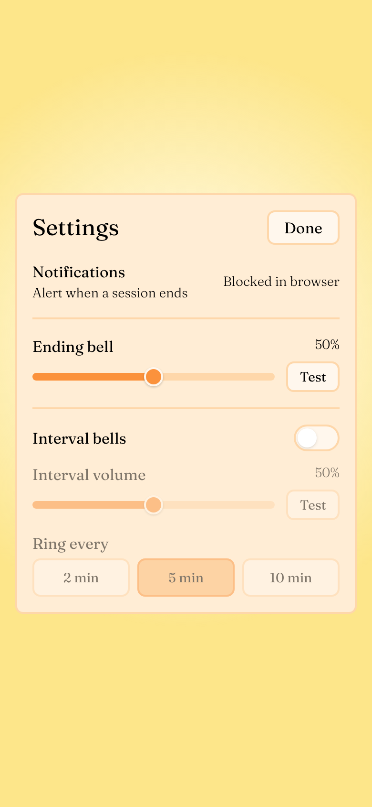

# Simple Meditations

A small, installable meditation timer for the web. Pick a duration, press start, and it rings a bell at the end. Optional interval bells mark the time along the way.

**Live:** [simple-meditations.netlify.app](https://simple-meditations.netlify.app/)
**Status:** Complete (v1.0). This was my first Next.js project, and I'm treating it as finished.

<p align="center">
  
  
  
</p>

## Features

- **Session timer** with quick lengths (5, 10, 20, 30 min), 5-minute steps or any typed length, with pause and resume
- **Fits on one screen**: every view fits a phone screen without scrolling, down to an iPhone SE with Safari toolbars showing
- **Interval bells** every 2, 5 or 10 minutes, with their own volume
- **End-of-session notification** and bell
- **Keeps the screen awake** during a session ([Screen Wake Lock API](https://developer.mozilla.org/en-US/docs/Web/API/Screen_Wake_Lock_API)), plus a **dim mode** so the phone can rest face-up without lighting up the room
- **Session history**: total sessions and minutes, stored locally on the device
- **Installable PWA** that works offline once loaded
- **Sunlight theme**: warm yellow with a soft glow of light behind the content that slowly breathes during a session (still when paused or with reduced motion on)

## How it works

| Piece | Where | What it does |
| --- | --- | --- |
| Timer worker | `public/timer.js` | Ticks in a Web Worker, so the countdown isn't slowed down by work on the main thread. |
| End-time based countdown | `app/ui/meditations.tsx` | The timer stores *when the session ends*, not how much time is left, so an interrupted tab catches up to the correct time immediately. |
| Wake lock | `app/ui/pwa.tsx` (`useWakeLock`) | Holds a screen wake lock while the timer is running, and takes it again when the page becomes visible. |
| Notifications | `app/ui/pwa.tsx` (`showNotification`) | Sends notifications through the service worker (required on Android), falling back to `new Notification()`. |
| Service worker | `public/sw.js` | Pre-caches the shell and bell sound. Network-first for pages, cache-first for hashed assets. |

Built with Next.js, React, TypeScript and Tailwind CSS. Deployed as a static site on Netlify.

## What I learned

The goal was a meditation timer you could start, lock your phone, and trust to ring at the end. Building it taught me where the web platform stops.

**Mobile operating systems suspend web pages when the screen turns off.** iOS and Android freeze background tabs and installed PWAs to save battery: timers, Web Workers and audio included. Service workers can't schedule work for later, and Web Push needs a server to wake the device. So a web app alone can't reliably ring a bell at a set time with the screen off. A native app can, because it can schedule a local notification or alarm with the OS.

Instead of fighting that, the final version designs around it:

1. **Keep the screen on, but make that comfortable.** A wake lock plus a near-black dim mode.
2. **Never be wrong about the time.** The countdown is calculated from an absolute end time, so if the page is suspended anyway, it shows the correct time (and finishes the session) as soon as you come back.
3. **Say so honestly.** If a browser doesn't support wake locks, the timer tells you to keep the screen open.

Other things this project taught me:

- How Web Workers, service workers and the Notifications API fit together, and their quirks on each platform (e.g. Android requiring `ServiceWorkerRegistration.showNotification`)
- Caching strategies for a PWA, and how one missing file in `cache.addAll` silently breaks offline support
- React effect dependencies: an unstable value in a dependency array caused the timer worker to restart every second
- Keeping server-rendered pages and browser-only APIs (`localStorage`, `navigator`) apart in Next.js

## Running locally

```bash
npm install
npm run dev
```

Then open [https://localhost:3000](https://localhost:3000). The dev server uses HTTPS so notification and wake lock APIs are available. The service worker only registers in production builds:

```bash
npm run build && npm start
```

## Credits

Bell sound: [Yoga Meditation Bells by CogFireStudio](https://freesound.org/people/CogFireStudios/sounds/683672/)
