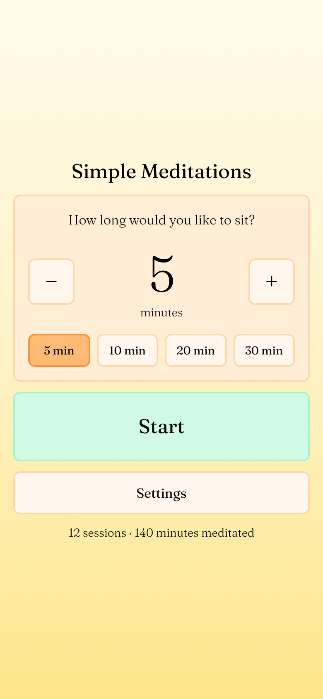
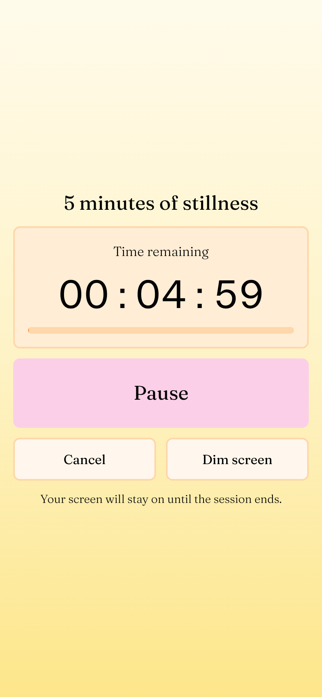

# Simple Meditations

A small, installable meditation timer for the web. Pick a duration, press start, and it rings a bell at the end. Optional interval bells mark the time along the way.

**Live:** [simple-meditations.netlify.app](https://simple-meditations.netlify.app/)
**Status:** Complete (v1.0). This was my first Next.js project, and I'm treating it as finished.

<p align="center">
  
  
  
</p>

## Features

- **Session timer** with quick lengths (5, 10, 20, 30 min), 5-minute steps or any typed length, with pause and resume
- **Fits on one screen**: every view fits a phone screen without scrolling, down to an iPhone SE with Safari toolbars showing
- **Interval bells** every 2, 5 or 10 minutes, with their own volume
- **End-of-session notification** and bell
- **Keeps the screen awake** during a session ([Screen Wake Lock API](https://developer.mozilla.org/en-US/docs/Web/API/Screen_Wake_Lock_API)), plus a **dim mode** so the phone can rest face-up without lighting up the room
- **Session history**: total sessions and minutes, stored locally on the device
- **Installable PWA** that works offline once loaded
- **Sunlight theme**: warm yellow with a soft glow of light behind the content that slowly breathes during a session (still when paused or with reduced motion on)

## How it works

| Piece | Where | What it does |
| --- | --- | --- |
| Timer worker | `public/timer.js` | Ticks in a Web Worker, so the countdown isn't slowed down by work on the main thread. |
| End-time based countdown | `app/ui/meditations.tsx` | The timer stores *when the session ends*, not how much time is left, so an interrupted tab catches up to the correct time immediately. |
| Wake lock | `app/ui/pwa.tsx` (`useWakeLock`) | Holds a screen wake lock while the timer is running, and takes it again when the page becomes visible. |
| Notifications | `app/ui/pwa.tsx` (`showNotification`) | Sends notifications through the service worker (required on Android), falling back to `new Notification()`. |
| Service worker | `public/sw.js` | Pre-caches the shell and bell sound. Network-first for pages, cache-first for hashed assets. |

Built with Next.js, React, TypeScript and Tailwind CSS. Deployed as a static site on Netlify.

## Retrospective

### Why I built it

Simple Meditations is a meditation web app inspired by an iOS app I found myself using a lot during college, [Oak](https://www.oak.spa/). It was my first project using React and Next.js, and my first time using a CSS framework like Tailwind CSS.

### A timer you can trust with your eyes closed

At first, I just wanted to see if I could make a simple timer on the web. Then I wanted to make that timer dependable for someone who is about to close their eyes for a set amount of time, and who might well fall asleep halfway through!

Knowing what I know now, that was an overcomplicated goal for a web app. Getting the timer itself right was the easy part: I moved it into a Web Worker so it wouldn't be slowed down by the page, and measured elapsed time with `performance.now()` instead of counting `setInterval` ticks, which drift. The hard part was letting the person know the session was over. The app works fine on desktop, but not on phones, where people tend to turn their screens off.

### Where the web stops

Mobile operating systems suspend web pages when the screen turns off. iOS and Android freeze background tabs and installed PWAs to save battery, including their timers, Web Workers and audio. Service workers can't schedule work for later either, and Web Push needs a server to wake the device. So a web app alone can't reliably ring a bell at a set time with the screen off. A native app can, because it can ask the OS to schedule a local notification or alarm.

(Technically, I could have generated an audio track that plays for the whole session, keeping the page alive by taking over the phone's media controls. But I'm not an audio engineer, it goes against the calm, simple experience I wanted, and from my research it isn't reliable anyway.)

### What I ended up with

Instead of fighting the platform, the final version works with it:

1. **Keep the screen on, but make that comfortable.** The app holds a screen wake lock during a session, and a **Dim screen** button switches to a near-black view. On an OLED screen, black pixels are switched off, so it's a clean solution with little battery drain.
2. **Never be wrong about the time.** `performance.now()` was a good fit while the page was running, but it can't help while the page is frozen. The countdown is now calculated from an absolute end time, so if the phone suspends the page anyway, the timer shows the correct time (and finishes the session) as soon as you come back.
3. **Be honest about it.** If a browser can't keep the screen awake, the timer says so.

### Being selective about dependencies

I came to JavaScript from Python. The React tutorial felt as polished as the Django tutorial, so I felt ready to pick up Next.js. What I didn't anticipate was how much faster the JavaScript ecosystem moves than the Python one I was used to. There is polish, but the documentation can be ambiguous, breaking changes and updates land quickly, and many packages are in the middle of refactors.

This repository shows it: it started on Next.js 14.2.13 in September 2024, has had 42 Dependabot pull requests merged since, and moved two major versions to Next.js 16, which removed the `next lint` command the project's lint script relied on. That taught me not to pick up a package just because it makes my current problem easier, and to count the cost of keeping it up to date.

### Smaller lessons from finishing it

Coming back to the project to finish it as v1.0 turned up a few bugs worth remembering:

- One missing file in the service worker's `cache.addAll` list silently disabled offline support.
- An unstable value in a React effect's dependency array restarted the timer worker every second.
- Session history was saved to `localStorage` under the key `"[object Object]"` because the object was passed instead of its name.
- Android Chrome doesn't allow `new Notification()` from a page; notifications have to go through the service worker.

## Running locally

```bash
npm install
npm run dev
```

Then open [https://localhost:3000](https://localhost:3000). The dev server uses HTTPS so notification and wake lock APIs are available. The service worker only registers in production builds:

```bash
npm run build && npm start
```

## Credits

Bell sound: [Yoga Meditation Bells by CogFireStudio](https://freesound.org/people/CogFireStudios/sounds/683672/)
